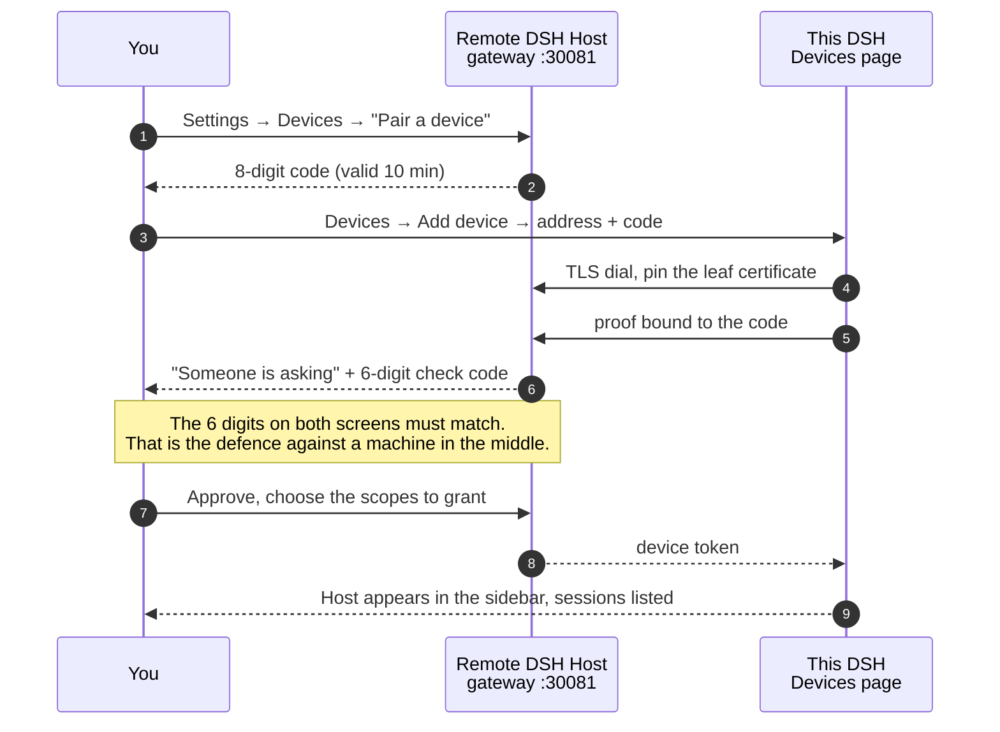
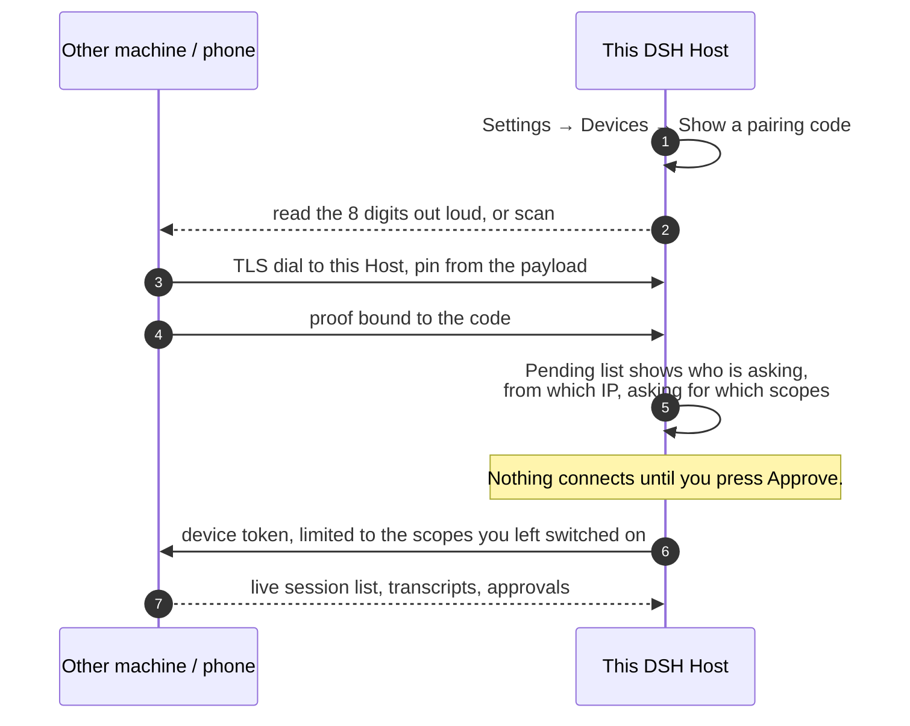
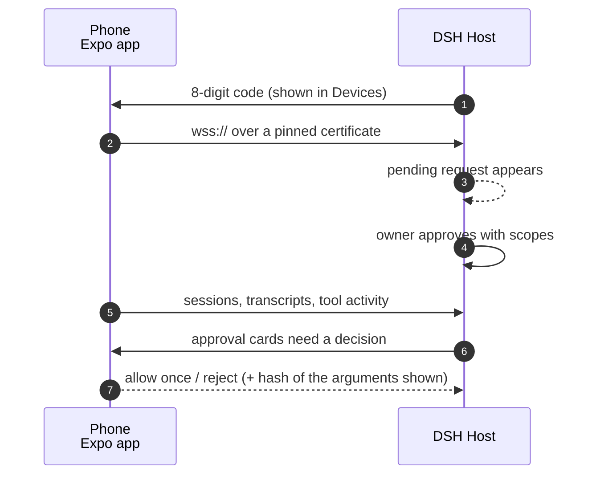
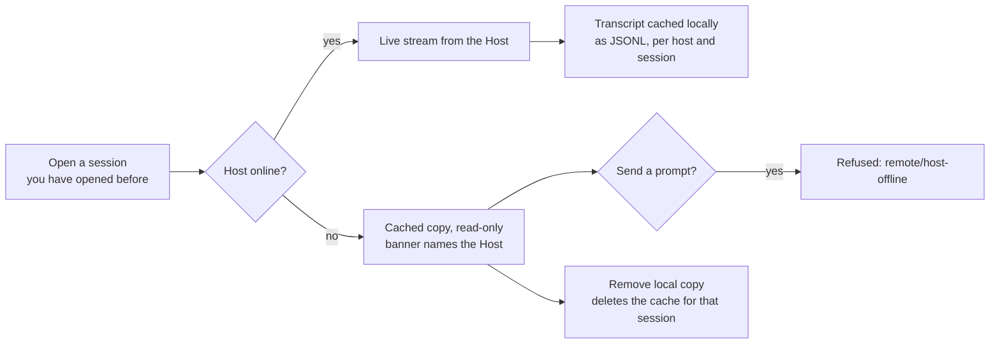
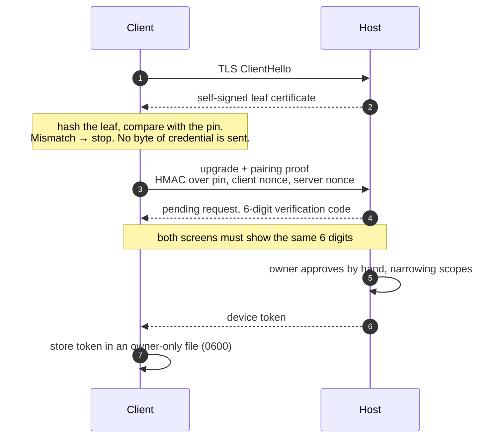

# DSH Remote

Work in your DeepSeek Harness sessions from anywhere: another computer, a phone,
or a machine in another room. The Host keeps doing the work — the files, the
models, the tools — and you drive it from wherever you are.

This is a plugin for the DSH desktop app. You do not install a second
application and you do not replace anything: it adds a **Devices** page to
Settings, and it teaches the existing sidebar and conversation to show a remote
Host's sessions next to your local ones.

*[Đọc bằng tiếng Việt →](README.vi.md)*

---

## What you actually get

- A **Devices** page in Settings: issue a pairing code, approve whoever is
  asking, see what you have paired, revoke it.
- **Remote sessions in the native UI.** A Host you connected to appears in the
  sidebar as its own group, with its workspaces and sessions. Click one and it
  opens in the ordinary conversation view — same transcript, same approval cards
  — with a small chip telling you which machine you are looking at.
- **Approvals and questions stay yours.** When a remote tool call needs a
  decision, the card shows up in your conversation, and your answer travels back
  to the Host that asked.
- **Read-only copies when the Host is offline.** Transcripts you have already
  opened stay readable, clearly marked, and sending a prompt is refused instead
  of silently queued.
- **Per-device scopes.** A phone that only watches is not a phone that can run
  commands. You choose what each device may do, and you can revoke one without
  touching the others.
- **Models come from the Host.** A remote session uses the model catalog of the
  machine doing the work, not of the machine you are typing on.

Everything listens on loopback by default. Nothing is reachable from another
machine until you say so.

---

## What is in this repository

| Path | What it is |
|---|---|
| `plugins/devices/` | `@dsh-ext/devices` — the Devices page, the outbound pinned client, the sidebar/conversation integration |
| `plugins/mobile-gateway/` | `@dsh-ext/mobile-gateway` — the Host-side gateway: TLS listener, pairing, device registry, remote bridge |

The gateway is a hardened fork of an upstream project and ships **no interface of
its own** here: its management routes are driven by the Devices page. The
upstream mobile client, which this gateway was originally written for, lives in
its own repository — see [NOTICE](NOTICE.md) for the attribution, which is kept
verbatim because the code is MIT-licensed upstream.
| `packages/mobile-protocol/` | `@dsh-ext/mobile-protocol` — the wire contract both sides share |
| `apps/mobile-companion/` | `@dsh-ext/mobile-companion` — the phone app (React Native + Expo) |
| `specs/` | the design and task records for the pieces above |

## Requirements

- DeepSeek Harness **0.2.2-rc.1** (the plugin declares `engines.dsh` and refuses
  to run on a version it has not been reviewed against)
- Node **24.9+** for the plugin code
- For the phone app: Node 24.9+, and the Expo toolchain

## Install

From a checkout:

```bash
git clone https://github.com/nesteacold/dsh-remote.git
cd dsh-remote

# into the profile DSH boots (adjust the profile name if yours differs)
dsh plugin --profile desktop add ./plugins/mobile-gateway
dsh plugin --profile desktop add ./plugins/devices
dsh plugin --profile desktop add ./packages/mobile-protocol
```

Then add both bundles to the profile's `dsh.profile.bundles` list — `@dsh-ext/mobile-gateway`
and `@dsh-ext/devices` — and start DSH.

**After any change to this code, reload the plugin** instead of restarting the
app: Settings → Plugins → toggle *Devices* off and on. The running process holds
the plugin module in memory and will happily serve last week's code otherwise.
We learned that the hard way.

---

## The three ways to connect

### 1. Drive another machine's Host from this one

The other machine runs DSH. You pair to it once, and its sessions show up in
your sidebar.



What you end up with: the remote Host's workspaces in their own sidebar group,
its sessions nested underneath, a host chip in the composer, and approval cards
that arrive in your conversation. Prompts you send are executed on that machine,
by its tools, on its files.

### 2. Let another machine (or your phone) drive this Host

This is the same thing from the other side, and it is how the phone app works.



Two windows, one decision. The code alone does not let anybody in — a human on
this machine has to look at the pending request and approve it, and can narrow
the scopes while doing so.

### 3. Watch the phone companion

`apps/mobile-companion` speaks the same contract, so a phone pairs the same way
and gets the same scope model.



The phone never runs DSH code. It monitors, approves and steers; the Host
executes. No JS runtime, no native modules of ours, no PTY on the phone.

### When the Host is not reachable



The cache holds session frames only — never a token, never a credential.

---

## How pairing is protected



The certificate pin is the whole server-authentication decision. There is no CA
in the picture, which is deliberate: the gateway makes its own certificate, and
relying on the platform's chain builder means different TLS implementations
disagree about a self-signed leaf. Pinning the exact leaf works everywhere, and
copying the certificate without its private key does not let anyone impersonate
the Host.

Revocation is immediate: revoking a device closes its socket with code 4401, and
the client deletes its stored token on that code.

## Scopes

A device gets exactly what you grant. Presets exist because a list of eleven
checkboxes is not a good first-run experience.

| Scope | What it allows |
|---|---|
| `sessions:read` | list sessions, read transcripts |
| `prompt:send` | send a prompt into a session |
| `approval:respond` | answer approval and question cards |
| `files:read` | read files through the Host |
| `harness:remote` | appear in the native sidebar/conversation (needed for the desktop-client experience) |
| `commands:execute` | run commands on the Host |
| `workspace:manage` | create and delete workspaces |
| `settings:write` | change Host settings, including the session's model |
| `credentials:write` | change Host credentials |
| `plugins:manage` | enable, disable, install plugins |
| `schedule:write` | create and edit scheduled tasks |
| `terminal` | open a terminal on the Host |

**Standard** is `sessions:read` + `prompt:send` + `approval:respond`.
**Full control** is everything above. Full control is genuinely full control —
grant it to a machine you own, not to a borrowed laptop.

Rate limits and payload caps default to **0, meaning unlimited**. Set them per
Host if you want a guard rail; they are not there by default.

## Reachable from another machine

The gateway binds `127.0.0.1` out of the box, so a fresh install can only be
used by the machine it runs on. That is intentional, and it is also the first
thing that stops people, so the Devices page says it out loud and lets you fix
it from there.

Open Settings → Devices and pick a **Connection plan**:

- **Loopback** — only this machine. The default.
- **LAN** — the first private address the operating system reports. Not
  necessarily your home network: on a machine with a VPN or a WireGuard/Docker
  adapter, that adapter can be reported first, so the page shows the address it
  actually bound and says so when it is not a plain household LAN.
- **Tailscale** — this machine's Tailscale address, if one is detected. This is
  the one to use: reachable from your own devices, invisible to everyone else,
  and no router configuration. The page shows the `wss://` URL to paste into the
  app once the switch is done.

Whichever you pick, the page shows the address the listener really took, and the
choice is remembered across restarts as long as the machine still owns that
address. Picking nothing exposes nothing — the default stays loopback.

If you would rather pin it in the profile, one config block does the same:

```yaml
- id: mobile-gateway
  name: "@dsh-ext/mobile-gateway"
  config:
    lanEnabled: true
    lanHost: 100.64.0.7   # a private LAN address, or this machine's Tailscale address
    lanPort: 30081
```

If `30081` is already taken, the listener moves to the next free port by itself
and says so in the log. The page also warns when the port sits inside the
operating system's dynamic range, where an outbound connection can take it at
any moment.

**The certificate does not need to be regenerated when the address changes.**
The client pins the leaf hash and never compares hostnames, so the SANs of the
existing certificate are irrelevant. Switching does drop the listener for a
moment and does not cut off a connection that is already open — it is a move,
not a kill switch. Turning the gateway off is the kill switch.

## Troubleshooting

**"Only this machine can connect"** — the gateway is bound to loopback. Pick a
Connection plan on the Devices page, or set `lanHost` as above and reload the
plugin.

**My change to the plugin did nothing** — toggle the plugin in Settings →
Plugins, or restart DSH. A file edit alone is not enough.

**A session refuses to open** — if the session was created by a subagent, DSH
requires it to be addressed with its durable parent. This plugin does that
automatically; a client written by hand has to send
`{ kind: 'subagent', parentSessionId, childSessionId, mode }` instead of
`{ kind: 'session', sessionId }`, or it gets `session/agent-busy`, which sounds
like "the agent is busy" but is not.

**`remote/ws-missing`** — `ws` was not found for `@dsh-ext/devices`. Install it
in that package; today the plugin borrows the copy from `plugins/mobile-gateway`
when both are present.

## What this does not do

- It does not expose a Host to the internet. The Cloudflare tunnel, the
  `cloudflared` download and the one-command public setup are **disabled** in
  this version, deliberately. Use Tailscale or a VPN you control.
- It does not let a device push a scope upgrade on itself. Re-pairing is the way
  to widen a grant, and that goes through the owner again.
- While a remote host is connected, the grouped sidebar **replaces** the shipped
  workspace browser. Row decorations other plugins add to session rows — a
  scheduled-task mark, an integration's icon — do not render in that mode. This is
  a limit of the slot system rather than a missing call: the shell lets a
  component render a child slot only when its own registration declares that
  child, and the shipped browser still declares all of them underneath, so
  declaring them here throws and takes the grouped sidebar down with it. The rows
  keep every affordance of their own: open, pin, archive, unread dot.
- Tested on Windows with DSH 0.2.2-rc.1. The phone module has Android and iOS
  native code; the iOS side has been built but not run on a device by us.

## Tests

```bash
cd plugins/devices && npm test                 # 14 suites, includes a real in-process gateway
cd plugins/mobile-gateway && node --test --test-isolation=none test/remote-bridge.test.mjs
cd apps/mobile-companion && npm test
```

`--test-isolation=none` is not optional on Windows: the default isolation fails
with `EPERM` there.

Before trusting this tree, check that it is complete:

```bash
node tools/verify-publish.mjs
```

It resolves every relative import in the shipped packages and checks that each
test file named by `npm test` exists. It exists because this repo once shipped
without six Host-side modules that had never been committed upstream, which made
the gateway impossible to start while the client half installed fine.

The pairing code has a regression test that seeds a leaf issued by a CA the
client never receives, so the test fails on any runtime that decides trust by
chain building rather than by the pin.

## License

MIT. See [LICENSE](LICENSE) and [NOTICE.md](NOTICE.md). This project forks the
gateway from **Clarklevis1995** and adapts the carrier-wrapping approach from
**liguobao/ds-harness-remote**; both are MIT, and both are credited there.
