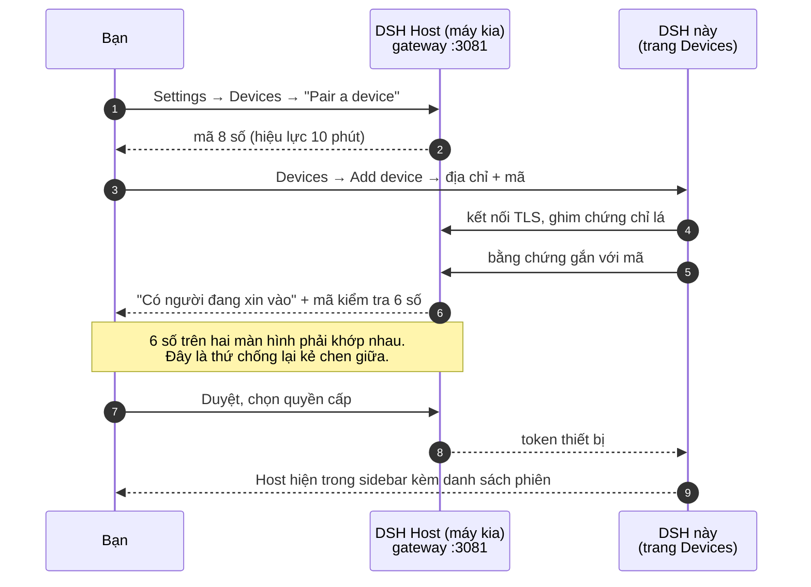
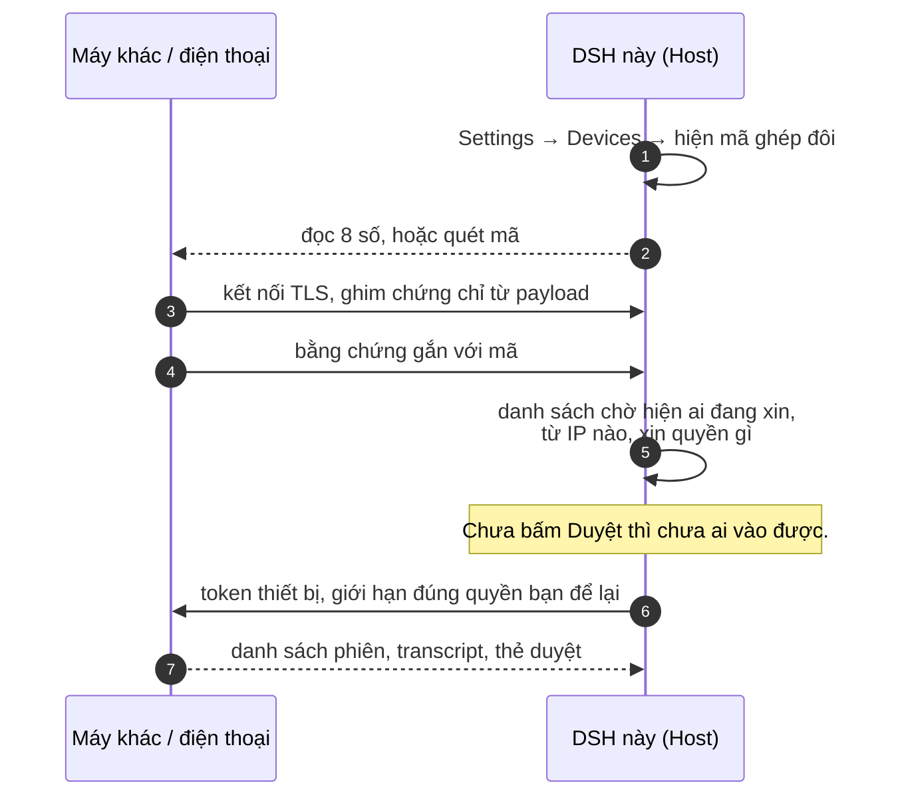
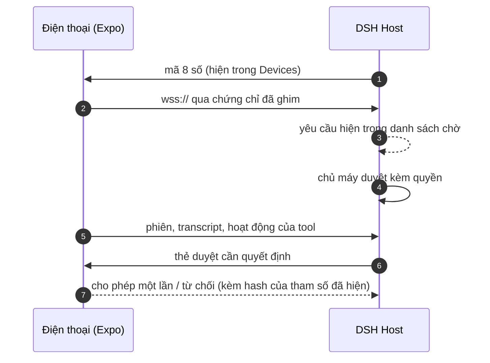
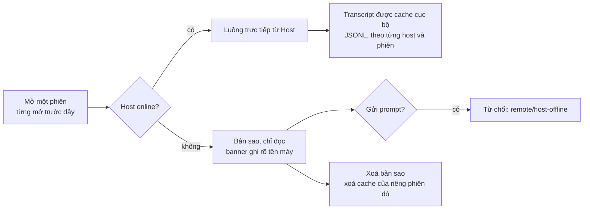
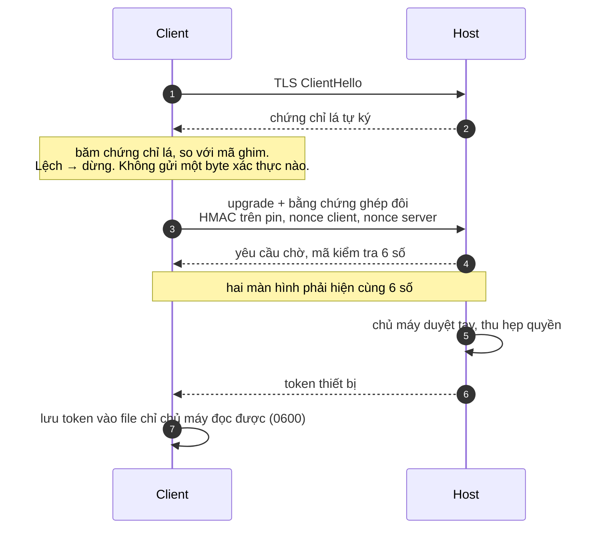

# DSH Remote

Làm việc với phiên DeepSeek Harness của bạn từ bất kỳ đâu: máy khác, điện thoại,
hay một máy nằm ở phòng khác. Máy Host vẫn là nơi chạy thật — file, model, công
cụ đều ở đó — bạn chỉ ngồi ở chỗ khác mà điều khiển.

Đây là plugin cho ứng dụng DSH desktop. Không cài thêm ứng dụng thứ hai, không
thay thế gì cả: nó thêm một trang **Devices** vào Settings, và dạy cho sidebar
cùng khung hội thoại sẵn có cách hiển thị phiên của máy remote bên cạnh phiên
local.

*[Read in English →](README.md)*

---

## Bạn thực sự nhận được gì

- **Trang Devices** trong Settings: phát mã ghép đôi, duyệt ai đang xin vào, xem
  đã ghép những thiết bị nào, thu hồi bất cứ lúc nào.
- **Phiên remote hiện trong UI gốc.** Máy bạn đã kết nối hiện thành một nhóm
  riêng trong sidebar, kèm workspace và session của nó. Bấm vào là mở ngay
  trong khung hội thoại quen thuộc — cùng transcript, cùng thẻ duyệt — chỉ thêm
  một chip nhỏ cho biết bạn đang nhìn máy nào.
- **Duyệt và trả lời câu hỏi vẫn là quyền của bạn.** Khi một tool call bên máy
  kia cần quyết định, thẻ duyệt hiện ra ngay trong hội thoại của bạn, và câu trả
  lời được gửi về đúng máy đã hỏi.
- **Đọc lại được khi máy kia offline.** Những phiên bạn từng mở vẫn xem được,
  có ghi chú rõ là bản sao, và gửi prompt thì bị từ chối chứ không âm thầm xếp
  hàng đợi.
- **Quyền theo từng thiết bị.** Điện thoại chỉ để xem không nên là điện thoại
  chạy được lệnh. Bạn chọn từng quyền, và thu hồi một máy mà không đụng máy khác.
- **Model lấy theo máy Host.** Phiên remote dùng danh mục model của máy đang
  chạy thật, không phải máy bạn đang gõ phím.

Mặc định mọi thứ chỉ nghe trên loopback. Chưa có gì truy cập được từ máy khác
cho đến khi bạn bật.

---

## Trong repo có gì

| Đường dẫn | Nội dung |
|---|---|
| `plugins/devices/` | `@dsh-ext/devices` — trang Devices, client ghim chứng chỉ, phần tích hợp sidebar/hội thoại |
| `plugins/mobile-gateway/` | `@dsh-ext/mobile-gateway` — gateway phía Host: TLS listener, ghép đôi, sổ thiết bị, cầu nối remote |
| `packages/mobile-protocol/` | `@dsh-ext/mobile-protocol` — hợp đồng wire dùng chung |
| `apps/mobile-companion/` | `@dsh-ext/mobile-companion` — app điện thoại (React Native + Expo) |
| `specs/` | ghi chép thiết kế và task của các phần trên |

## Yêu cầu

- DeepSeek Harness **0.2.2-rc.1** (plugin khai báo `engines.dsh` và từ chối chạy
  trên phiên bản chưa được review)
- Node **24.9+**
- Với app điện thoại: Node 24.9+ và toolchain Expo

## Cài đặt

```bash
git clone https://github.com/nesteacold/dsh-remote.git
cd dsh-remote

# cài vào profile mà DSH của bạn khởi động (đổi tên profile nếu khác)
dsh plugin --profile desktop add ./plugins/mobile-gateway
dsh plugin --profile desktop add ./plugins/devices
dsh plugin --profile desktop add ./packages/mobile-protocol
```

Sau đó thêm hai bundle vào danh sách `dsh.profile.bundles` của profile —
`@dsh-ext/mobile-gateway` và `@dsh-ext/devices` — rồi khởi động DSH.

**Sau mỗi lần sửa code, hãy nạp lại plugin** thay vì restart app: Settings →
Plugins → tắt rồi bật *Devices*. Tiến trình đang chạy giữ module plugin trong bộ
nhớ, nên nếu không làm vậy nó sẽ phục vụ bạn bản code cũ. Chúng tôi biết điều này
vì đã mất một buổi để hiểu tại sao bản sửa không có tác dụng.

---

## Ba cách kết nối

### 1. Điều khiển máy khác từ máy này

Máy kia chạy DSH. Ghép đôi một lần, phiên của nó hiện trong sidebar của bạn.



Kết quả: workspace của máy kia nằm trong nhóm riêng của sidebar, session lồng
bên dưới, có chip tên máy trong ô soạn tin, và thẻ duyệt hiện ngay trong hội
thoại của bạn. Prompt bạn gửi được chạy trên máy đó, bằng công cụ của máy đó,
trên file của máy đó.

### 2. Cho máy khác (hoặc điện thoại) điều khiển máy này

Cùng việc đó nhìn từ phía bên kia — và đây là cách app điện thoại hoạt động.



Hai cửa sổ, một quyết định. Chỉ có mã thì không vào được — phải có người ngồi ở
máy này nhìn danh sách chờ và bấm duyệt, và có thể thu hẹp quyền ngay lúc duyệt.

### 3. Xem qua app điện thoại

`apps/mobile-companion` nói cùng một hợp đồng, nên điện thoại ghép đôi y như vậy
và dùng đúng mô hình quyền đó.



Điện thoại không chạy code DSH. Nó theo dõi, duyệt và điều hướng; máy Host thực
thi. Không JS runtime, không native module của chúng tôi, không PTY trên điện
thoại.

### Khi máy Host không tới được



Cache chỉ chứa frame của phiên — không bao giờ chứa token hay thông tin xác thực.

---

## Ghép đôi được bảo vệ thế nào



Mã ghim chứng chỉ **là toàn bộ** quyết định xác thực máy chủ. Không có CA ở đây,
và đó là cố ý: gateway tự tạo chứng chỉ, còn tin vào bộ xây chuỗi của hệ điều
hành thì mỗi runtime TLS lại phán một kiểu với chứng chỉ tự ký. Ghim đúng lá
chứng chỉ thì chạy được ở mọi nơi — và copy được chứng chỉ mà không có khoá
riêng thì cũng không giả được máy chủ.

Thu hồi có hiệu lực ngay: thu hồi thiết bị sẽ đóng socket với mã 4401, và client
xoá token đã lưu khi nhận mã đó.

## Quyền (scopes)

Thiết bị chỉ có đúng những gì bạn cấp. Có preset vì mười một ô checkbox không
phải trải nghiệm tốt cho lần đầu.

| Quyền | Cho phép |
|---|---|
| `sessions:read` | liệt kê phiên, đọc transcript |
| `prompt:send` | gửi prompt vào một phiên |
| `approval:respond` | trả lời thẻ duyệt và câu hỏi |
| `files:read` | đọc file qua Host |
| `harness:remote` | hiện trong sidebar/hội thoại gốc (cần cho trải nghiệm desktop-client) |
| `commands:execute` | chạy lệnh trên Host |
| `workspace:manage` | tạo và xoá workspace |
| `settings:write` | đổi cài đặt Host, gồm cả model của phiên |
| `credentials:write` | đổi thông tin xác thực của Host |
| `plugins:manage` | bật, tắt, cài plugin |
| `schedule:write` | tạo và sửa tác vụ định giờ |
| `terminal` | mở terminal trên Host |

**Standard** gồm `sessions:read` + `prompt:send` + `approval:respond`.
**Full control** là tất cả. Full control đúng nghĩa là toàn quyền — cấp cho máy
của chính bạn, đừng cấp cho một laptop mượn.

Giới hạn tần suất và kích thước payload mặc định là **0, tức không giới hạn**.
Muốn có rào chắn thì đặt riêng cho từng Host; mặc định không có.

## Để máy khác truy cập được

Gateway mặc định bind `127.0.0.1`, nên bản cài mới chỉ dùng được trên chính máy
đó. Đây là chủ ý — nhưng cũng là chỗ làm nhiều người bế tắc đầu tiên, nên trang
Devices giờ nói thẳng ra và chỉ luôn chỗ đổi.

Muốn dùng từ máy khác, đặt địa chỉ lắng nghe trong cấu hình gateway:

```yaml
- id: mobile-gateway
  name: "@dsh-ext/mobile-gateway"
  config:
    lanEnabled: true
    lanHost: 100.64.0.7   # địa chỉ LAN nội bộ, hoặc địa chỉ Tailscale của máy này
    lanPort: 3081
```

Địa chỉ Tailscale là lựa chọn tốt hơn: máy của bạn vào được, người ngoài không
thấy, và không phải cấu hình router.

**Đổi địa chỉ không cần tạo lại chứng chỉ.** Client ghim hash của lá chứng chỉ
và không so tên miền, nên SANs của chứng chỉ cũ không còn ý nghĩa.

## Xử lý sự cố

**"Chỉ máy này kết nối được"** — gateway đang bind loopback. Đặt `lanHost` như
trên rồi nạp lại plugin.

**Sửa code mà không thấy tác dụng** — tắt/bật plugin trong Settings → Plugins,
hoặc restart DSH. Chỉ sửa file là không đủ.

**Một phiên không mở được** — nếu phiên đó do subagent tạo, DSH đòi phải gọi
bằng địa chỉ gốc của nó. Plugin này tự làm việc đó; client tự viết tay thì phải
gửi `{ kind: 'subagent', parentSessionId, childSessionId, mode }` thay vì
`{ kind: 'session', sessionId }`, nếu không sẽ nhận `session/agent-busy` — nghe
như "agent đang bận" nhưng không phải vậy.

**`remote/ws-missing`** — không tìm thấy `ws` cho `@dsh-ext/devices`. Cài nó vào
package đó; hiện tại plugin mượn bản trong `plugins/mobile-gateway` khi cả hai
cùng có mặt.

## Những gì plugin này không làm

- Không đưa Host ra internet. Cloudflare tunnel, tải `cloudflared`, và lệnh cấu
  hình public một phát là **đã tắt** trong phiên bản này, có chủ ý. Dùng
  Tailscale hoặc VPN do bạn kiểm soát.
- Không cho thiết bị tự nâng quyền của chính nó. Muốn mở rộng quyền thì ghép
  lại, và phải qua tay chủ máy.
- Nút thiết bị riêng ở chân sidebar của gateway (từ upstream) vẫn còn và trùng
  một phần với trang Devices. Đang nằm trong danh sách dọn.
- Mới kiểm trên Windows với DSH 0.2.2-rc.1. Module điện thoại có code native cho
  Android và iOS; phía iOS đã build được nhưng chúng tôi chưa chạy trên máy thật.

## Test

```bash
cd plugins/devices && npm test                 # 15 nhóm, có gateway thật chạy trong tiến trình
cd plugins/mobile-gateway && node --test --test-isolation=none test/remote-bridge.test.mjs
cd apps/mobile-companion && npm test
```

Phần ghép đôi có test hồi quy dùng một lá chứng chỉ do CA mà client không bao
giờ nhận được, nên test sẽ fail trên bất kỳ runtime nào quyết định tin cậy bằng
cách xây chuỗi thay vì bằng mã ghim.

## Giấy phép

MIT. Xem [LICENSE](LICENSE) và [NOTICE.md](NOTICE.md) — dự án fork gateway từ
**Clarklevis1995** và phỏng theo cách bọc carrier của
**liguobao/ds-harness-remote**, cả hai đều MIT, và cả hai đều đáng được cảm ơn.
