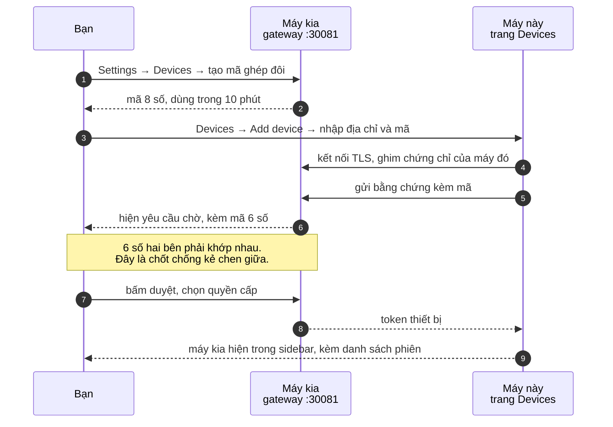
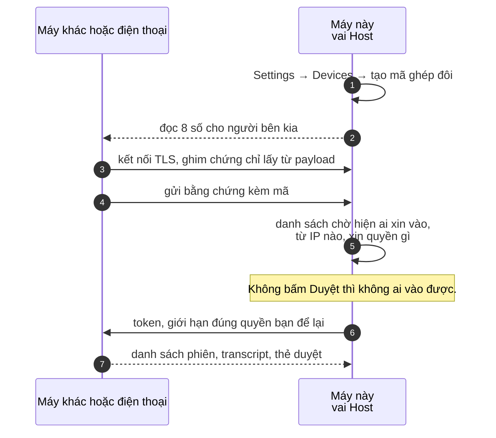
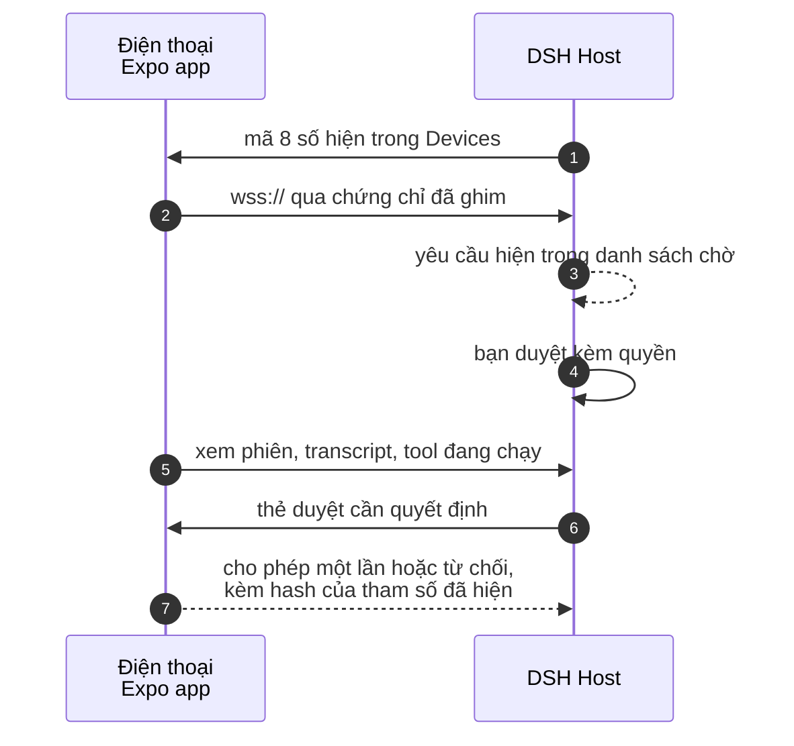
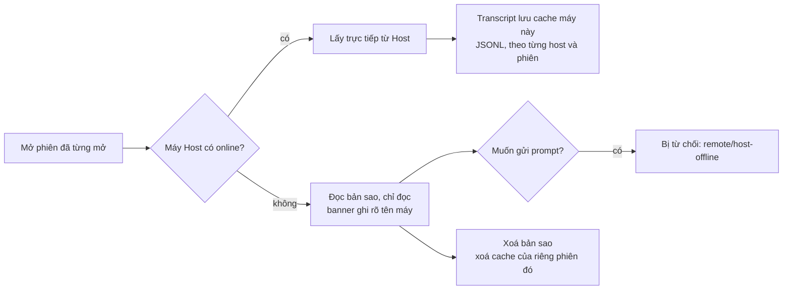
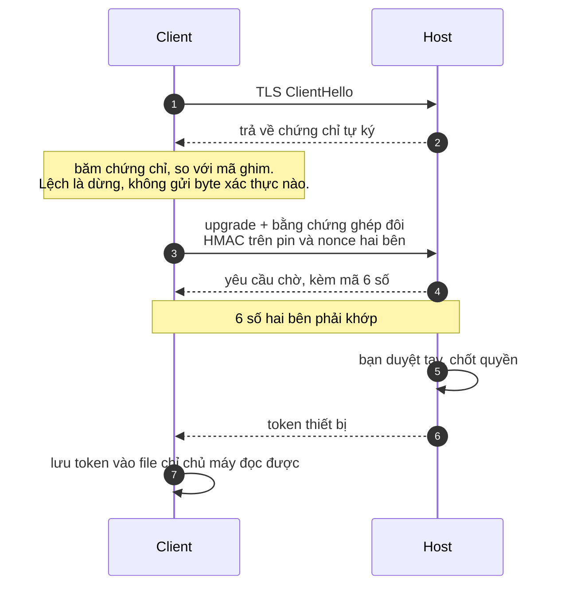

# DSH Remote

Mở phiên DeepSeek Harness của bạn ở bất cứ đâu: máy khác, điện thoại, hay cái máy
để ở phòng bên. Mọi thứ vẫn chạy trên máy Host — file, model, tool đều ở đó —
bạn ngồi chỗ khác điều khiển.

Đây là plugin cho app DSH desktop. Không phải cài thêm app thứ hai, cũng không
thay thế gì: nó thêm trang **Devices** vào Settings, và dạy sidebar với khung chat
sẵn có cách hiện phiên của máy remote ngay cạnh phiên local.

*[Read in English →](README.md)*

---

## Bạn được gì

- **Trang Devices trong Settings**: tạo mã ghép đôi, duyệt ai đang xin vào, xem
  đã ghép máy nào, thu hồi lúc nào cũng được.
- **Phiên remote hiện ngay trong UI gốc.** Máy bạn đã kết nối thành một nhóm
  riêng trong sidebar, kèm workspace và session của nó. Bấm vào là mở trong khung
  chat quen thuộc — cùng transcript, cùng thẻ duyệt — chỉ thêm cái chip nhỏ cho
  biết đang xem máy nào.
- **Duyệt và trả lời câu hỏi vẫn do bạn quyết.** Bên kia có tool call cần duyệt
  thì thẻ hiện ra ngay trong khung chat của bạn, bạn chọn gì thì gửi về đúng máy
  đã hỏi.
- **Máy kia offline vẫn đọc lại được.** Những phiên bạn từng mở vẫn xem được, có
  ghi rõ là bản sao; còn gửi prompt thì bị từ chối luôn chứ không âm thầm xếp vào
  hàng đợi.
- **Phân quyền theo từng thiết bị.** Cái điện thoại chỉ để xem thì không thể chạy
  lệnh. Bạn chọn từng máy được làm gì, và thu hồi một máy mà không ảnh hưởng máy
  khác.
- **Model lấy theo máy Host.** Phiên remote dùng danh sách model của máy đang
  chạy thật, không phải máy bạn đang gõ.

Mặc định mọi thứ chỉ nghe trên loopback. Bạn chưa bật thì máy khác không vào được.

---

## Trong repo có gì

| Đường dẫn | Nội dung |
|---|---|
| `plugins/devices/` | `@dsh-ext/devices` — trang Devices, client ghim chứng chỉ, phần nối vào sidebar và khung chat |
| `plugins/mobile-gateway/` | `@dsh-ext/mobile-gateway` — gateway phía Host: TLS listener, ghép đôi, sổ thiết bị, cầu nối remote |

Gateway là bản fork đã gia cố của một dự án upstream, và ở đây nó **không kèm giao
diện riêng**: toàn bộ route quản lý của nó do trang Devices điều khiển. App mobile
của upstream — lý do ban đầu gateway này ra đời — nằm ở repo riêng của họ; phần ghi
công ở [NOTICE](NOTICE.md) được giữ nguyên văn vì code upstream là MIT.
| `packages/mobile-protocol/` | `@dsh-ext/mobile-protocol` — hợp đồng wire dùng chung |
| `apps/mobile-companion/` | `@dsh-ext/mobile-companion` — app điện thoại (React Native + Expo) |
| `specs/` | ghi chép thiết kế và task của các phần trên |

## Cần gì để chạy

- DeepSeek Harness **0.2.2-rc.1** (plugin khai báo `engines.dsh` và không chạy
  trên bản chưa được review)
- Node **24.9+**
- App điện thoại thì cần thêm Node 24.9+ và toolchain Expo

## Cài đặt

```bash
git clone https://github.com/nesteacold/dsh-remote.git
cd dsh-remote

# cài vào profile mà DSH của bạn khởi động (đổi tên profile nếu khác)
dsh plugin --profile desktop add ./plugins/mobile-gateway
dsh plugin --profile desktop add ./plugins/devices
dsh plugin --profile desktop add ./packages/mobile-protocol
```

Rồi thêm hai bundle `@dsh-ext/mobile-gateway` và `@dsh-ext/devices` vào danh sách
`dsh.profile.bundles` của profile, sau đó khởi động DSH.

**Sửa code xong thì nạp lại plugin**, đừng restart app: Settings → Plugins → tắt
rồi bật lại *Devices*. Tiến trình đang chạy giữ module plugin trong RAM, không nạp
lại thì nó phục vụ bạn code cũ mà bạn không biết. Mình đã vấp đúng chỗ này.

---

## Ba cách kết nối

### 1. Từ máy này điều khiển máy khác

Máy kia chạy DSH. Ghép đôi một lần là phiên của nó hiện trong sidebar của bạn.



Kết quả: workspace của máy kia nằm trong nhóm riêng của sidebar, session lồng bên
dưới, có chip tên máy trong ô soạn tin. Prompt bạn gửi được chạy trên máy đó, bằng
tool của máy đó, trên file của máy đó.

### 2. Cho máy khác (hoặc điện thoại) điều khiển máy này

Đúng việc trên nhưng nhìn từ phía máy bị điều khiển — app điện thoại chạy theo
cách này.



Hai cửa sổ, một quyết định. Có mã cũng không tự vào được — phải có người ngồi máy
này nhìn danh sách chờ mà bấm duyệt, và có thể bớt quyền ngay lúc duyệt.

### 3. Xem qua app điện thoại

`apps/mobile-companion` nói cùng một hợp đồng, nên điện thoại ghép đôi y hệt và
dùng đúng mô hình quyền đó.



Điện thoại không chạy code DSH. Nó xem, duyệt và điều hướng; máy Host thực thi.
Không JS runtime, không native module của mình, không PTY trên điện thoại.

### Khi không tới được máy Host



Cache chỉ chứa frame của phiên — không có token, không có thông tin xác thực.

---

## Vì sao ghép đôi an toàn



Mã ghim chứng chỉ là **toàn bộ** việc xác thực máy chủ. Không có CA ở giữa, và
đó là cố ý: gateway tự ký chứng chỉ, còn nếu để bộ xây chuỗi của hệ điều hành
quyết thì mỗi runtime TLS lại phán một kiểu với chứng chỉ tự ký — OpenSSL chấp
nhận, BoringSSL của Electron thì từ chối. Ghim đúng chứng chỉ đó thì chạy đâu
cũng được, và có được chứng chỉ mà không có private key thì cũng không giả được
máy chủ.

Thu hồi có hiệu lực ngay: thu hồi thiết bị là đóng socket với mã 4401, client nhận
mã đó thì xoá luôn token đã lưu.

## Scope — thiết bị được làm gì

Thiết bị có đúng những gì bạn cấp. Có preset vì lần đầu mà bắt tick mười một ô thì
quá mệt.

| Quyền | Cho phép |
|---|---|
| `sessions:read` | xem danh sách phiên, đọc transcript |
| `prompt:send` | gửi prompt vào một phiên |
| `approval:respond` | trả lời thẻ duyệt và câu hỏi |
| `files:read` | đọc file qua Host |
| `harness:remote` | xuất hiện trong sidebar và khung chat gốc (cần cho trải nghiệm desktop client) |
| `commands:execute` | chạy lệnh trên Host |
| `workspace:manage` | tạo và xoá workspace |
| `settings:write` | đổi cài đặt Host, kể cả model của phiên |
| `credentials:write` | đổi thông tin xác thực trên Host |
| `plugins:manage` | bật, tắt, cài plugin |
| `schedule:write` | tạo và sửa tác vụ hẹn giờ |
| `terminal` | mở terminal trên Host |

**Standard** gồm `sessions:read` + `prompt:send` + `approval:respond`.
**Full control** là tất cả những cái trên. Full control đúng nghĩa là toàn quyền —
cấp cho máy của bạn, đừng cấp cho cái laptop đi mượn.

Giới hạn tốc độ và kích thước payload mặc định là **0, tức không giới hạn**. Muốn
có rào thì đặt riêng cho từng Host; mặc định không có.

## Muốn máy khác vào được

Mặc định gateway bind `127.0.0.1`, nên cài xong thì chỉ máy đó dùng được. Cố ý
như vậy, và cũng chính là chỗ đầu tiên làm người ta tắc, nên trang Devices nói
thẳng ra và cho đổi ngay tại đó.

Vào Settings → Devices, chọn **Connection plan**. Có ba lựa chọn:

- **Loopback** — chỉ máy này. Mặc định.
- **LAN** — địa chỉ riêng đầu tiên mà hệ điều hành báo cáo. Không hẳn là mạng
  trong nhà: máy nào có VPN hay adapter WireGuard/Docker thì adapter đó có thể
  được báo trước, nên trang hiện đúng địa chỉ nó đã gắn vào và nói rõ khi đó
  không phải LAN thường.
- **Tailscale** — địa chỉ Tailscale của máy này, nếu có. Cái này nên dùng: máy
  của bạn vào được, người ngoài không thấy, không phải đụng vào router. Đổi xong
  trang hiện luôn URL `wss://` để nhập vào app.

Chọn cái nào thì trang cũng hiện đúng địa chỉ mà listener đã nhận, và lựa chọn
được nhớ qua lần khởi động sau, miễn máy vẫn còn địa chỉ đó. Chưa chọn thì chưa
mở thêm gì — mặc định vẫn là loopback.

Không muốn bấm trong app thì đặt thẳng trong config, kết quả y như vậy:

```yaml
- id: mobile-gateway
  name: "@dsh-ext/mobile-gateway"
  config:
    lanEnabled: true
    lanHost: 100.64.0.7   # IP LAN nội bộ, hoặc địa chỉ Tailscale của máy này
    lanPort: 30081
```

Port `30081` bận thì listener tự nhảy sang port trống kế tiếp và ghi rõ trong
log. Trang cũng cảnh báo nếu port rơi vào dải port động của hệ điều hành, vì ở
đó một kết nối ra ngoài có thể giành mất port bất cứ lúc nào.

**Đổi địa chỉ không cần tạo lại chứng chỉ.** Client ghim hash của chứng chỉ và
không so tên miền, nên SAN trong chứng chỉ cũ không ảnh hưởng gì. Đổi địa chỉ
làm listener rớt ra một nhịp, và nó không cắt kết nối đang mở — đây là chuyện
dời chỗ, không phải công tắc ngắt. Muốn ngắt thì tắt gateway.

## Khi có trục trặc

**Nó báo "chỉ máy này kết nối được"** — gateway đang bind loopback. Vào trang
Devices chọn Connection plan, hoặc đặt `lanHost` như trên rồi nạp lại plugin.

**Sửa code mà không thấy gì đổi** — tắt/bật plugin trong Settings → Plugins, hoặc
restart DSH. Chỉ sửa file là chưa đủ.

**Có phiên mở không được** — nếu phiên đó do subagent tạo, DSH bắt phải gọi bằng
địa chỉ có parent. Plugin này tự làm việc đó; client tự viết tay thì phải gửi
`{ kind: 'subagent', parentSessionId, childSessionId, mode }` thay vì
`{ kind: 'session', sessionId }`, không thì sẽ nhận `session/agent-busy` — đọc
tưởng là "agent đang bận" nhưng không phải vậy.

**`remote/ws-missing`** — không tìm thấy `ws` cho `@dsh-ext/devices`. Cài nó vào
package đó; hiện plugin đang mượn bản trong `plugins/mobile-gateway`.

## Những gì nó không làm

- Không đưa Host ra internet. Cloudflare tunnel, tải `cloudflared` và lệnh setup
  public một phát đều **đã tắt** trong bản này, cố ý. Dùng Tailscale hoặc VPN của
  bạn.
- Không cho thiết bị tự nâng quyền của chính nó. Muốn mở rộng thì ghép lại, và
  phải qua tay bạn.
- Nút thiết bị ở chân sidebar của upstream vẫn còn, trùng một phần với trang
  Devices. Đang nằm trong danh sách dọn.
- Mới test trên Windows với DSH 0.2.2-rc.1. App điện thoại có code native cho
  Android và iOS; phía iOS đã build được nhưng chưa chạy trên máy thật.

## Test

```bash
cd plugins/devices && npm test                 # 14 nhóm, có gateway thật chạy trong tiến trình
cd plugins/mobile-gateway && node --test --test-isolation=none test/remote-bridge.test.mjs
cd apps/mobile-companion && npm test
```

`--test-isolation=none` không phải tuỳ chọn trên Windows: chế độ isolation mặc
định ở đó chết với `EPERM`.

Trước khi tin cây này đủ, kiểm tra:

```bash
node tools/verify-publish.mjs
```

Nó resolve mọi import tương đối trong các package được publish và kiểm tra từng
file test mà `npm test` nhắc tới có tồn tại. Script này có vì repo từng publish
thiếu sáu module phía Host chưa bao giờ được commit ở upstream: phần client cài
bình thường, còn gateway thì không khởi động được.

Phần ghép đôi có test hồi quy cố tình dùng chứng chỉ do một CA mà client không hề
nhận — nên test sẽ fail trên bất kỳ runtime nào quyết định tin cậy bằng cách xây
chuỗi thay vì bằng mã ghim.

## Giấy phép

MIT. Xem [LICENSE](LICENSE) và [NOTICE.md](NOTICE.md). Gateway fork từ
**Clarklevis1995**, cách bọc carrier phỏng theo **liguobao/ds-harness-remote** —
cả hai đều MIT, và mình ghi công cả hai ở đó.
